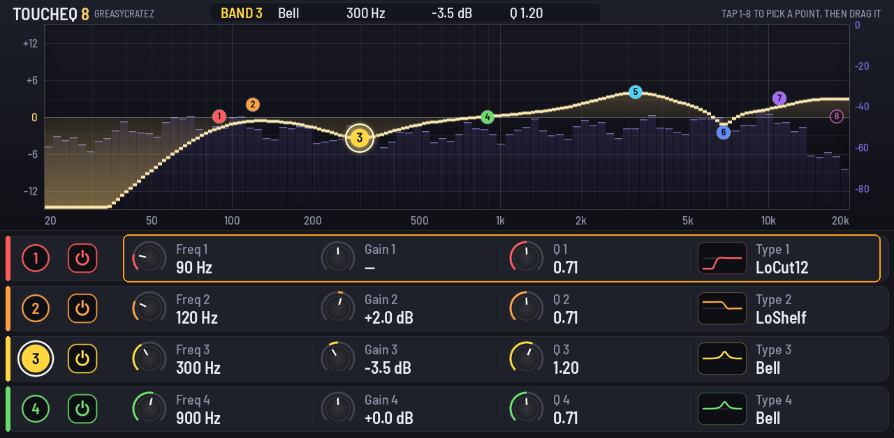

# TouchEQ 8 for MPC

An 8-band parametric EQ for standalone Akai MPCs (built on an MPC Key 61), in the spirit of the big desktop
"graph" EQs. It has a live filled curve, a spectrum analyser, and band points you drag with a finger. Each band is a
row of four Q-Link knobs: Freq, Gain, Q, Type. User guide: [plugins/TouchEQ8/README.md](plugins/TouchEQ8/README.md).

**First release (0.1.3).** Tested on an MPC Key 61 (MPC OS 3.10.1); please report what you find on other models.



## Install

Needs MPC OS 3.10.1 or later. On the MPC: **Menu > Preferences > Enhancements**, tick **Enable Enhancements** and
**External Plugin Support**, accept the warning, then restart the MPC.

### With the OpenMPC Plugin Manager (easiest)

The [Open MPC catalog](https://open-mpc.github.io/) lists TouchEQ 8 (id `toucheq-8`), and its Plugin Manager
installs, updates and removes it for you.

1. **Get the Plugin Manager onto the MPC (once).** Follow
   [Install the Plugin Manager](https://open-mpc.github.io/install.html): download its `-mpc-sdk.zip`, unzip it, and
   copy the folder `OpenMPC - VST - Plugin Manager` into `VST2 Plugins` on a USB stick, an SD card or the MPC's
   internal drive.
2. **Open it.** Add a Plugin track and choose **External VST Plugins > OpenMPC > Plugin Manager**.
3. **Find TouchEQ 8.** Browse on the MPC's screen, or open the web address shown on the Plugin Manager's status line
   on a phone or computer on the same Wi-Fi.
4. **Install.** Pick TouchEQ 8, press **Apply**, and let the MPC restart once.
5. **Use it.** On an audio, drum or plugin track, add an insert effect: **External VST Plugins > GreasyCratez >
   TouchEQ 8**.

To **update**, install the newer version the same way. To **remove** it, select it under **Installed**, press
**Remove**, then **Apply**. Your projects are kept.

**Can't find it?** The catalog lists a plugin only after its entry is merged and the nightly catalog build has
run. Beta versions (GitHub pre-releases) show up only in the beta channel.

### By hand

Download `TouchEQ-8-<version>-mpc-sdk.zip` from the [Releases](../../releases) page and unzip it. Copy the folder
`GreasyCratez - VST - TouchEQ 8` into a folder named `VST2 Plugins` at the root of an MPC drive, then restart the
MPC. One folder works on every model, 32-bit and 64-bit. To remove it, delete the folder.

The `-mpc-armv7.zip` (Key 61, Key 37, Live, Live II, One, X, Force) and `-mpc-aarch64.zip` (64-bit models) on each
release are the catalog's packages. The Plugin Manager uses them, and each one also carries its own `install.sh` and
`INSTALL.md` for installing over SSH.

## How the graph is made

MPC plugin screens are JSON plus images; a plugin cannot draw on them. So the plugin **publishes** what the graph
shows as read-only parameters, and the skin draws them:

| Layer (bottom to top) | Widgets | Bound to |
|---|---|---|
| Analyser | 96 vertical sliders, revealed from the bottom | `Spectrum 01..96` (post-EQ FFT, -90..0 dBFS, 4.5 dB/oct tilt) |
| Curve | 192 vertical sliders, revealed from the 0 dB line, bright cap | `Curve 001..192` (the EQ's magnitude response, +-15 dB) |
| Touch shield | an empty component | stops a finger from moving a column |
| Points | 8 bands x 3 type groups x on/off XY pads, display only | `Freq n` (x), `Gain n` or `Q n` (y) |
| Grab pad | the selected band's XY pad, on top | the same |

Band-number buttons are film-strip images inside a component whose actions toggle a `Pick n` trigger (the plugin
then sets `Band`) and, while `QLink Follow` is on, bank the Q-Links to that band's row.

The plugin recomputes the curve on a screen thread when a parameter changes and announces the columns that moved,
up to 30 times a second.
Previews: [docs/skin-preview/](docs/skin-preview/). Design notes: [docs/DESIGN.md](docs/DESIGN.md).

## Build

```
./build.sh          # Linux or WSL: DSP tests (+ASan/UBSan), plugin (native + arm32 + arm64), skin, SDK validation,
                    # host_sim, end-to-end test of the real library, zip
./build.sh test     # DSP tests only
```

Needs g++, python3 with Pillow, and zig. The SDK is cloned into `.deps/` at a pinned commit.

### Release

```
./release.sh <owner/repo>   # after ./build.sh: the open-mpc zips (armv7, aarch64), their catalog check, the
                            # hand-copy SDK zip and SHA-256 sums, in release/
```

Uses open-mpc's `sdk_release.py`, `catalog_check.py` and `sdk_zip.py` from `.deps/mpc-vst-plugins` (pinned commit).
Device tests go in [tested.json](tested.json).

* DSP: `common/toucheq_engine.h` (header-only, shared with the tests). Plugin: `plugins/TouchEQ8/src/TouchEQ8.cpp`.
* Screen: `tools/make_skin.py` writes every image, `TUI.json` and `Q-Links.json` from code.
* **The parameter order is frozen**, because saved projects and the skin depend on it. Only ever append.

## Status

**On the MPC Key 61 (MPC OS 3.10.1.12), 0.1.3:** the curve and analyser follow the controls live, the points drag
the right way up, the band-number buttons select a band and (QLink Follow) bank the Q-Links to its row. Occasional
clicks while dragging fast were traced to the number of screen updates sent to the MPC; 0.1.3 budgets them (see
[docs/DESIGN.md](docs/DESIGN.md)). Not measured on the device yet: CPU per instance.

**Offline, every build:** 53 DSP checks (also under ASan/UBSan; every filter type's measured audio matches the drawn
curve within 0.1 dB), Akai SDK validation (0 errors, 0 warnings), host_sim (20 pass), and an end-to-end test of the
real library (curve, analyser, band picking, state, host-notification budget in real time). ThreadSanitizer clean.

## Credits and license

MIT, see [LICENSE](LICENSE). Filters: A. Simper's published "Linear trap optimised SVF" equations (Cytomic, 2013); no
third-party code. Built with Akai's MIT-licensed MPC Plugin SDK (fetched at build time, not included). Fonts: Barlow
Semi Condensed (SIL Open Font License, [tools/fonts/OFL.txt](tools/fonts/OFL.txt)); only images rendered from it ship
in the plugin. Akai, MPC and any other product names belong to their owners; this project is not affiliated with them.
